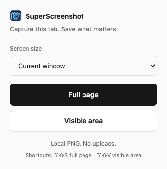
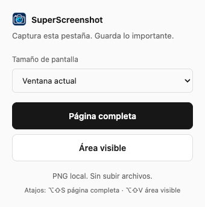

# SuperScreenshot

A local-first Chrome extension for full-page, visible-area and responsive screenshots.

[English](#english) · [Español](#español)




## English

**Choose a screen size. Capture. Copy or save a PNG.** No account, uploads or analytics.

This maintained fork builds on [soymangomez/superscreenshot](https://github.com/soymangomez/superscreenshot). Wolfvus's additions include verified iPad/iPhone viewport emulation, temporary capture cleanup, a simpler interface, English/Spanish localization and capture regression checks.

### Install and capture

1. Clone or download this repository.
2. Open `chrome://extensions` and enable **Developer mode**.
3. Select **Load unpacked**, choose the repository folder and pin the extension.
4. Open a webpage. Choose **Current window**, **iPad** or **iPhone 15 Pro**, then **Full page** or **Visible area**.
5. In the preview, **Copy**, **Save PNG**, zoom or **Delete** the capture.

The interface follows Chrome's language: Spanish for Spanish-language Chrome, English otherwise. Reload the extension after changing Chrome's language. The preview, context menus, shortcuts and error messages are localized; website content and native browser errors keep their own language.

Shortcuts: **Alt+Shift+S** (full page), **Alt+Shift+V** (visible area). On macOS: **⌥⇧S** / **⌥⇧V**. You can also right-click a page to capture it.

### Privacy and permissions

Captures stay in this extension's local IndexedDB while the preview is open. Closing the preview or selecting **Delete** removes the temporary image; files you explicitly download remain on disk. Save images you want to keep before closing their previews.

| Permission | Reason |
| --- | --- |
| `activeTab`, `<all_urls>` | Capture websites you select |
| `scripting` | Scroll, measure and temporarily hide repeating fixed elements |
| `debugger` | Emulate a mobile viewport and verify its capture dimensions |
| `contextMenus` | Add right-click capture actions |
| `storage`, `unlimitedStorage` | Track previews and hold large captures locally |

Mobile emulation may show Chrome's debugging banner. The extension restores the viewport and detaches on completion or cancellation. For local HTML files, enable **Allow access to file URLs** in the extension's settings.

### Limitations

- Chrome pages, the Chrome Web Store, DevTools and other protected tabs cannot be captured.
- Full-page capture stops at 80 tiles. Large images are scaled to browser canvas limits.
- Keep the target window focused during desktop capture. Close DevTools before mobile emulation.
- Dynamic layouts, infinite scrolling and unusual nested scrollers may need a visible-area capture.

### Development and checks

Plain HTML, CSS and JavaScript; no build step and no runtime dependencies. Reload the unpacked extension after editing.

- `popup.*`: capture controls; `preview.*`: stitching, zoom and export.
- `background.js`: capture lifecycle, emulation and cleanup; `content.js`: page measurements and restoration.
- `_locales/en` and `_locales/es`: Chrome message catalogs; `i18n.js`: shared UI localization.
- [Long-page fixture](examples/long-page.html): 2700px page with a fixed header for capture checks.

Run dependency-free catalog and stitching checks with `node --test tests/unit.mjs`. The actual-extension browser test uses Playwright Chromium in a fresh disposable profile:

```sh
npm install --no-save --package-lock=false playwright@1.62.1
npx playwright install chromium
node tests/extension.mjs
```

The test checks desktop and mobile dimensions, stitched pixels, page restoration, cancellation, preview deletion and localized UI. If Playwright is already installed elsewhere, set `PLAYWRIGHT_PATH` to its `index.mjs`; no project install is needed. `ARTIFACT_DIR=/tmp/superscreenshot-check` saves UI screenshots. See [measured performance](docs/performance.md) for the fixture and comparison limits.

## Español

**Elige el tamaño de pantalla. Captura. Copia o guarda un PNG.** Sin cuentas, subidas ni analítica.

Esta versión mantenida parte de [soymangomez/superscreenshot](https://github.com/soymangomez/superscreenshot). Las mejoras de Wolfvus incluyen emulación verificada de iPad/iPhone, limpieza de capturas temporales, una interfaz más simple, traducción al español y pruebas de captura.

### Instalación y uso

1. Clona o descarga este repositorio.
2. Abre `chrome://extensions` y activa **Modo de desarrollador**.
3. Selecciona **Cargar descomprimida**, elige la carpeta del repositorio y fija la extensión.
4. Abre una página. Elige **Ventana actual**, **iPad** o **iPhone 15 Pro**, y después **Página completa** o **Área visible**.
5. En la vista previa, usa **Copiar**, **Guardar PNG**, los controles de zoom o **Eliminar**.

La interfaz sigue el idioma de Chrome: español si Chrome está en español; inglés en los demás casos. Recarga la extensión tras cambiar el idioma de Chrome. El contenido de los sitios y los errores del navegador conservan su propio idioma.

Atajos: **Alt+Shift+S** para página completa y **Alt+Shift+V** para área visible. En macOS: **⌥⇧S** / **⌥⇧V**. También puedes capturar desde el menú del botón derecho.

### Privacidad y límites

Las capturas se guardan temporalmente en el dispositivo y se eliminan al cerrar su vista previa o pulsar **Eliminar**. Los PNG que descargues permanecen en disco. Guarda lo que quieras conservar antes de cerrar la vista previa.

La emulación móvil restaura la pantalla y desconecta el depurador al terminar o cancelar. Chrome puede mostrar una barra de depuración. Las páginas protegidas no se pueden capturar; el límite es de 80 imágenes y los resultados muy grandes se reducen. Mantén la ventana enfocada durante una captura de escritorio y cierra las herramientas de desarrollo para emular dispositivos.

Para probar cambios, recarga la extensión y abre la [página de prueba](examples/long-page.html). Activa **Permitir acceso a URLs de archivos** si la abres como archivo local. Las instrucciones de pruebas automáticas y los permisos están en la sección en inglés.
